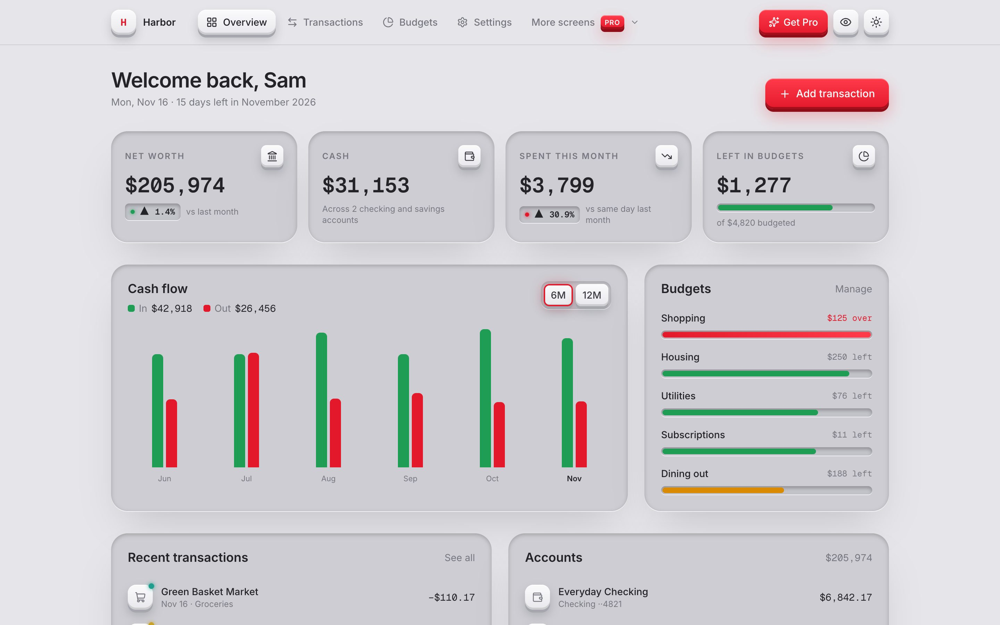

<div align="center">

# Harbor Lite

**A free personal finance dashboard with a tactile, hardware-inspired look.**<br>
Net worth, transactions and budgets, in light and dark. Built with [Thock UI](https://thock-ui.vercel.app).

[](LICENSE)


[**Full version demo**](https://harbor-finance-demo.vercel.app) · [**Thock UI**](https://thock-ui.vercel.app) · [**Get the full template**](https://thock-ui.vercel.app/templates/finance)

<picture>
  <source media="(prefers-color-scheme: dark)" srcset=".github/assets/overview-dark.jpg">
  
</picture>

</div>

## At a glance

| | |
| --- | --- |
| **Screens** | 4: overview, transactions, budgets, settings |
| **Looks** | Light and dark themes, works on phones and tablets |
| **Data** | A year of realistic demo transactions, ready to swap for your own |
| **Charts** | Plain HTML and CSS. No chart library to learn or ship |
| **Stack** | Next.js 16 (App Router), React 19, Tailwind CSS v4, Radix UI, lucide-react, next-themes |
| **Licence** | MIT: use it for anything, including commercial projects |

## Quick start

```bash
git clone https://github.com/intellaralabs/thock-finance-lite.git
cd thock-finance-lite
npm install
npm run dev        # open http://localhost:3000
```

Other scripts: `npm run build`, `npm start`, `npm run lint`.

## Screens

| Route | What it shows |
| --- | --- |
| `/` | Net worth, cash, spending this month, budget left, cash flow (6 or 12 months), budgets to watch, recent transactions, accounts |
| `/transactions` | Search, filter by flow, account and category, a "to review" filter, bulk categorise and mark reviewed, edit category and notes, add a transaction. `?category=dining` and `?q=coffee` open it pre-filtered |
| `/budgets` | Monthly budgets with a projected month-end, on track / at risk / over, rollover, and spending that has no budget yet |
| `/settings` | Profile, currency, hide balances, light/dark/system theme and notification switches |

The eye button in the header hides every balance.

## Project structure

```
app/                  layout.tsx (theme + state + shell) and one page per screen
components/ui/        Thock UI components (free, MIT; yours to edit)
components/lite/      app parts: shell, state provider, dialogs, screens
data/finance.ts       demo data and the types the UI expects
lib/finance.ts        money and date formatting, totals, budget progress
lib/links.ts          links to the full template; set showProPreviews = false to remove them all
styles/tactile.css    design tokens: colours, raised and recessed surfaces, LEDs
```

## Connect your own data

All state lives in `components/lite/finance-provider.tsx`. Screens only call `useFinance()` (`addTransaction`,
`updateTransactions`, `setBudget`, `removeBudget`, `setCurrency`, `setHidden`).

1. Load accounts and transactions from your API or an aggregator (Plaid, TrueLayer, GoCardless) instead of `data/finance.ts`.
2. In the provider, send each action to your backend as well as to the reducer.

Totals and budget progress are computed from transactions in `lib/finance.ts`, so they stay correct automatically.

## Make it yours

The "More screens" menu, the preview pages, the overview teaser, the "Get Pro" button, the settings card and the footer
link to the full template. One line in `lib/links.ts` switches them all off:

```ts
export const showProPreviews = false;
```

Then you can also delete `app/pro`, `data/pro-screens.ts`, `components/lite/pro-*.tsx` and `public/pro`. To restyle,
change the colour tokens in `styles/tactile.css`.

## Lite or full?

| | Lite (free) | [Full template](https://thock-ui.vercel.app/templates/finance) |
| --- | :---: | :---: |
| Screens | 4 | 13 + sign-in |
| Overview, transactions, budgets, settings | ✓ | ✓ |
| Light and dark, phone-ready | ✓ | ✓ |
| Accounts, account detail and transfers | | ✓ |
| Investments, allocation and holdings | | ✓ |
| Savings goals with forecasts and a wizard | | ✓ |
| Bills calendar and subscriptions | | ✓ |
| Month-vs-month reports and CSV export | | ✓ |
| Card controls: freeze, limits, virtual cards | | ✓ |
| Split transactions, date filters, ⌘K menu, toasts | | ✓ |
| Components | Free set | Free + Pro |
| Licence | MIT | Pro licence |

Try the full version: **[harbor-finance-demo.vercel.app](https://harbor-finance-demo.vercel.app)**

## Licence

[MIT](LICENSE) © Intellara Labs. Built with [Thock UI](https://thock-ui.vercel.app).
